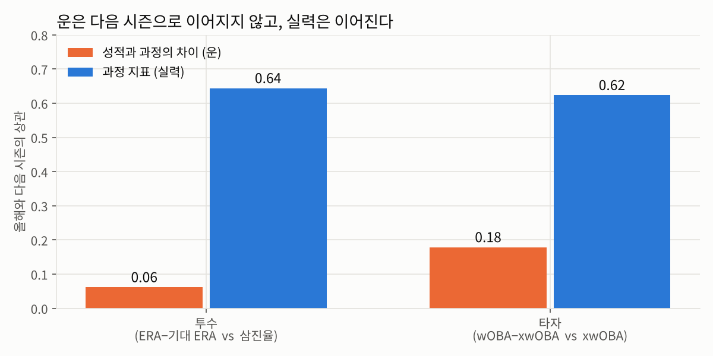
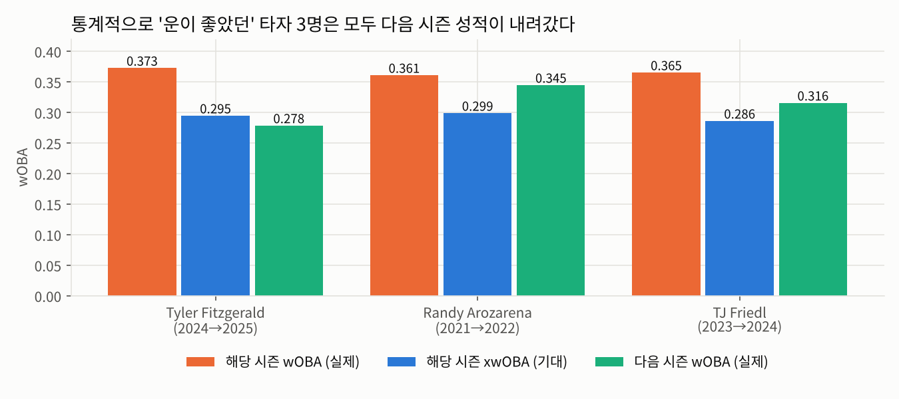
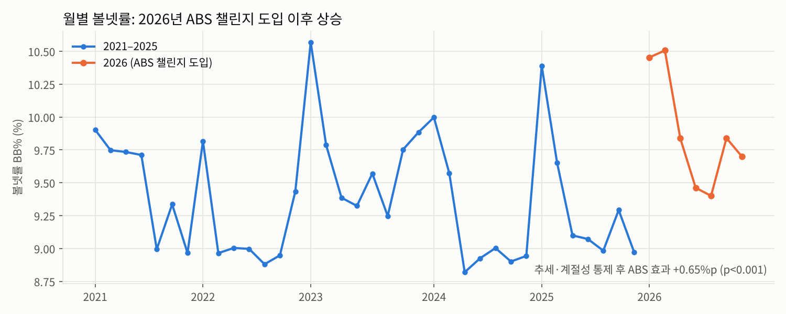

# 55만 개의 맞대결
### Statcast로 해부한 MLB 투수와 타자, 그리고 ABS 시대의 변화

MLB 2021–2026시즌 모든 투수와 타자의 투구 단위 데이터를 분석한 프로젝트입니다.
선수마다 구종, 위치, 결과를 하나하나 뜯어보고, 한 번도 만난 적 없는 투수와 타자가 맞붙으면 어떤 결과가 나올지 예측했습니다.
2026년에 도입된 ABS 챌린지, 즉 볼과 스트라이크를 자동으로 판정하는 제도가 경기를 어떻게 바꿨는지도 검증합니다.

## 핵심 결과

2021–2026시즌 투구 약 426만 개를 분석했습니다. 타석으로는 약 108만 개이고, 선수로는 투수 1,743명과 타자 1,662명입니다.

| 질문 | 결과 |
|---|---|
| 투수 유형은 실제로 존재하나? | 구종 비율을 빼고 구속, 회전, 무브먼트 같은 공의 물리 특성만으로 9개 유형을 **85.6%** 맞힘. 무작위 기준은 29.7% → 유형 구분은 실재함 |
| 유형에 따라 성적이 다른가? | 삼진, 볼넷, 헛스윙, 땅볼 비율은 유형마다 유의하게 다르고 그중 땅볼 효과가 가장 큼. 하지만 실점과 직결되는 xwOBA와 득점 가치는 차이 없음 → 유형은 *아웃을 잡는 방식*을 바꿀 뿐 *실점 억제력*을 정하지 않음 |
| 타자는 어떻게 나뉘나? | 스윙과 타구 지표로 선구 약점형, 장타 파워형, 컨택형의 3개 유형으로 나뉨. 다만 재표본 안정성은 ARI 0.74로 투수의 0.94보다 낮음 |
| 타자의 약점 코스는 우연인가? | 다중검정 보정 후에도 **66%의 타자-시즌**에서 헛스윙 구역이 특정 존에 뭉쳐 있음 → 약점 존은 우연이 아닌 실제 패턴 |
| 성적과 과정의 차이는 실력인가 운인가? | 기대 성적 대비 ERA 차이의 다음 시즌 지속성은 0.06, 삼진율은 0.64 → 차이는 대부분 운. 보정 후 유의하게 운이 좋았거나 나빴던 선수는 투수 0명, 타자 3명뿐 |
| ABS 챌린지가 경기를 바꿨나? | 추세와 계절성을 통제해도 볼넷률 **+0.65%p**, p<0.001. 존 밖 스트라이크 판정은 −1.09%p, 존 안은 +1.84%p → 판정이 규정 존에 가까워짐. 단, "경계 판정에 의존하던 투수가 더 손해 봤다"는 가설은 유의하지 않음 |
| 종합 지수는 쓸모 있나? | 투수 지수의 다음 시즌 성적 예측력은 0.36으로 xwOBA 단독의 0.31보다 높음. 타자 지수는 0.45로 xwOBA 단독의 0.46과 비슷 |
| 맞대결 예측은 얼마나 정확한가? | 2026시즌 18만 타석 기준으로 리그 평균보다 로그 손실이 약 1.2% 개선됨. 타석 결과 자체의 우연성이 커서 개선 폭은 작음 |

## 이 분석으로 무엇을 결정할 수 있나

### ① 선수 평가: 올해 성적이 아니라 과정 지표로 판단한다



성적과 과정의 차이, 즉 운은 다음 시즌 상관이 투수 0.06, 타자 0.18에 그칩니다. 반면 삼진율과 xwOBA 같은 과정 지표는 0.6 이상 이어집니다. 그러니 연봉 협상이나 영입 판단에서는 **올해 wOBA나 ERA가 아니라 xwOBA 같은 과정 지표에 무게를 둬야** 합니다.

이 판단이 실제로 맞는지 사후 검증했습니다. 다중검정 보정 후에도 유의하게 운이 좋았던 타자 3명은 **모두 다음 시즌 wOBA가 떨어졌습니다.**



같은 기준으로 2026시즌을 보면 다음 후보가 나옵니다. 400타석 이상 타자 기준이고, 개별 선수의 차이는 FDR 보정 후 유의하지 않으므로 **확정이 아니라 우선 검토 대상**으로 봐야 합니다.

| 구분 | 선수 | 2026 wOBA | 2026 xwOBA | 판단 근거 |
|---|---|---|---|---|
| 반등 후보 | Juan Soto | .383 | .412 | xwOBA 리그 상위 1%인데 실제 성적이 기대보다 낮음 |
| 반등 후보 | Bobby Witt Jr. | .354 | .379 | xwOBA 상위 약 2% |
| 반등 후보 | Corey Seager | .324 | .350 | xwOBA 상위 약 10% |
| 하락 주의 | Javier Sanoja | .359 | .296 | xwOBA는 리그 평균 이하인데 실제 성적이 기대를 크게 웃돎 |
| 하락 주의 | Ceddanne Rafaela | .339 | .283 | 같음 |

※ 발이 빠른 타자는 내야안타 덕분에 xwOBA를 꾸준히 웃도는 경향이 있어, 하락 주의 명단은 주력을 함께 보고 판단해야 합니다.

### ② 리그 정책: ABS 챌린지는 볼넷을 늘렸지만, 특정 투수에게 불리하지는 않았다



추세와 월별 계절성을 통제해도 2026년 볼넷률은 0.65%p 올랐고, 추세 항을 빼고 추정해도 +0.46%p로 유의해 모형 설정에 따라 결론이 바뀌지 않습니다. 존 밖 스트라이크 판정이 줄고 존 안 판정이 늘어 판정이 규정 존에 가까워졌습니다.

- 구단 입장: "경계 판정에 기대던 투수가 손해를 봤다"는 가설은 유의하지 않았습니다. **ABS를 이유로 투수 평가 기준을 바꿀 근거는 아직 없습니다.**
- 타자 육성 입장: 판정이 바뀐 존 위치가 지도로 나오므로, 타자의 스트라이크존 판단 훈련 기준을 2026년 판정 지도로 바꿀 수 있습니다.

### ③ 경기 전략: 상대 전적보다 선수 특성으로 맞대결을 판단한다

한 시즌에 가능한 투수와 타자 조합은 약 60만 쌍인데, 2021~2026시즌 전체를 합쳐도 20타석 이상 만난 쌍은 1,690쌍뿐입니다. "상대 타율 4할" 같은 상대 전적은 대부분 몇 타석짜리 기록이라 우연에 가깝습니다.

선수 특성으로 만든 예측은 리그 평균보다 로그 손실을 약 1.2% 줄이는 데 그쳤습니다. 개선 폭이 작은 건 한 타석의 결과 자체가 우연에 크게 좌우되기 때문입니다. 그래서 이 모델은 한 타석을 맞히는 용도가 아니라, **수십 타석이 쌓이는 시리즈 단위로 타순과 대타 기용을 비교하는 기준선**으로 쓰는 것이 맞습니다.

---

## 1. 연구 배경

### 성적 지표는 실력과 운을 구분하지 못한다
ERA나 타율 같은 전통 지표는 수비, 구장, 타구가 떨어진 위치처럼 우연의 영향을 크게 받습니다.
Statcast는 모든 공의 구속, 회전, 무브먼트, 위치와 모든 타구의 속도, 발사각을 측정합니다. 덕분에 결과가 아닌 **과정**으로 선수를 평가할 수 있게 됐습니다.

### 맞대결 기록은 너무 적다
한 시즌에 가능한 투수와 타자 조합은 50만 쌍이 넘지만, 실제 타석은 그보다 훨씬 적어서 대부분의 조합은 한 번도 만나지 않습니다.
많이 만난 쌍도 통산 10~20타석 수준이니 "상대 타율 4할" 같은 숫자는 대부분 우연이에요.
그래서 기록이 아니라 **선수의 특성으로 맞대결을 예측**하는 방법이 필요하다고 봤습니다.

### 2026년, 스트라이크존의 규칙이 바뀌었다
MLB는 2026시즌부터 ABS 챌린지를 도입했습니다. 주심의 볼, 스트라이크 판정에 선수가 이의를 제기하면 Hawk-Eye 추적 시스템이 판정하는 방식입니다.
존 경계 판정에 기대던 투수나 존을 잘 아는 타자에게 어떤 변화가 생겼는지는 아직 데이터로 검증된 적이 없습니다.

---

## 2. 연구 목표

| 목표 | 핵심 질문 |
|---|---|
| 선수 해부 | 이 투수는 어떤 공을, 어디로, 어떤 상황에 던지고, 각 공의 결과는 어떤가? 이 타자는 어떤 공과 어떤 존에 약한가? |
| 유형 재정의 | 선발과 불펜, 파워와 교타 같은 전통 분류 대신 데이터로 보면 선수는 어떤 유형으로 나뉘는가? |
| 기대 성적 | 올해 성적이 과정, 즉 타구의 질에 비해 과하거나 모자랐던 선수는 누구인가? 내년에 반등하거나 하락할 선수는? |
| 맞대결 예측 | 한 번도 만나지 않은 투수와 타자가 붙으면 어떤 결과가 나올까? |
| ABS 효과 | 자동 판정 챌린지 도입이 볼넷, 삼진, 판정 지도를 어떻게 바꿨고, 누가 손해를 봤는가? |

---

## 3. 데이터

| 데이터 | 출처 | 기간 | 단위 |
|---|---|---|---|
| 투구와 타구 추적 데이터: 구속, 회전수, 회전축, 무브먼트, 릴리스, 투구 위치, 타구속도, 발사각, 기대 성적, 배트 스피드 등 | Baseball Savant의 Statcast | 2021–2026 | 투구 1개, 시즌당 약 70만 구 |
| 시즌 성적: ERA, 이닝, 승패, 홈런, 타점, 도루 등 | MLB Stats API | 2021–2026 | 선수별 시즌 |
| 선수 정보: 생년월일, 투타 | MLB Stats API | – | 선수 |
| 세이버 지표: fWAR, wRC+, Stuff+ | FanGraphs, 선택 사항 | 2021–2026 | 선수별 시즌 |

### 전처리
- 본 분석에는 정규시즌만 쓰고, 포스트시즌은 따로 집계했습니다.
- 야수 등판은 뺐습니다. 패스트볼 평균이 84mph 미만이면서 300구 미만인 경우가 대상입니다.
- 좌투수는 수평 무브먼트 부호를 뒤집어, 좌우 투수 모두 팔 쪽이 +가 되도록 맞췄습니다.
- 선수별 스트라이크존 상단과 하단을 기준으로 존 안, 존 밖, 그리고 존 경계인 섀도 구역을 판정합니다.
- 트레이드된 선수는 팀별 기록을 합산했고, 이닝 표기는 아웃 수로 바꿨습니다. 예를 들어 `50.1`은 50⅓이닝입니다.
- 최소 표본은 투수 300구, 타자 150타석입니다. 기준을 바꿔도 결과가 유지되는지는 민감도 분석으로 확인했습니다.

---

## 4. 분석 과정

| 단계 | 질문 | 주요 방법 |
|---|---|---|
| 1. 선수 해부 | 이 선수는 어떤 공을 어디로 던지고, 어떤 공에 약한가 | 구종·존·카운트별 집계, 마르코프 구종 전이 |
| 2. 유형 분류 | 선수 유형은 실제로 존재하나 | 규칙 기반 유형, LDA, Kruskal-Wallis, K-means |
| 3. 요인 분석 | 무엇이 헛스윙과 생산성을 만드나 | LightGBM, TreeSHAP, 선수 단위 GroupKFold |
| 4. 기대 성적 | 성적과 과정의 차이는 운인가 | Huber 회귀, Newey-West HAC, FDR 보정 |
| 5. 공간 분석 | 약점 존은 우연인가 | Moran's I, LISA |
| 6. 맞대결 예측 | 처음 만나는 투수와 타자의 결과는 | Log5, 다항 로지스틱, LightGBM, 행렬 분해 |
| 7. ABS 효과 | 규칙 변화가 경기를 바꿨나 | 단절 시계열, 위약 검정 |
| 8. 시간 변화 | 나이와 구속은 어떻게 변하나 | 혼합효과모형, 변화점 탐지 |

단계별 상세 방법은 [docs/METHODS.md](docs/METHODS.md)에 정리했습니다.

### 모형 검증 종합
| 잠재 위협 | 검증 방법 |
|---|---|
| 다중공선성 | VIF 단계적 제거 |
| 군집 수 자의성 | 실루엣, Davies-Bouldin, BIC 비교 |
| 군집 불안정성 | 부트스트랩 ARI |
| 표본 기준 자의성 | 최소 투구 수와 타석 수를 올린 뒤 재군집 ARI |
| 과적합 | 선수 단위 GroupKFold 교차검증 |
| 이상치 | Huber vs OLS vs Theil-Sen 순위 상관, Q-Q 플롯 |
| 선형성 | 잔차 LOWESS 곡선 |
| 종합 지수 가중치 자의성 | 엔트로피 vs SHAP 가중 비교, 다음 시즌 예측력으로 선택 |
| 볼배합 효과 교란 | 구위와 구종 수를 통제한 회귀 |
| 자기상관 | Ljung-Box → Newey-West HAC |
| 다중검정 | Benjamini-Hochberg FDR |
| 데이터 누수 | 직전 시즌 특성 사용, 검증 시즌 완전 분리 |
| 맞대결 희소성 | 특성 기반 모델 + Log5 기준선 비교 |
| ABS 효과 착시 | 월 고정효과 + 추세 통제, 위약 검정 |
| 생존 편향 | 혼합효과모형 vs 델타 방법 비교 |

---

## 5. 결과물: Streamlit 대시보드

| 페이지 | 할 수 있는 것 |
|---|---|
| 투수 리포트 | 투수를 고르면 성적, 구종, 무브먼트, 위치 히트맵, 구종별 성적, 볼배합, 구속 변화까지 한 페이지에서 확인 |
| 타자 리포트 | 구종, 존, 구속대, 카운트별 약점과 LISA 핫스팟, 스프레이 차트 |
| 유형 지도와 SHAP | 유형 분류 지도, 유형별 레이더, 성적을 만드는 요인 |
| 종합 지수 | 엔트로피 가중과 SHAP 가중으로 만든 0~100점 투수, 타자 지수와 순위표 |
| 맞대결 시뮬레이터 | 아무 투수와 타자를 골라 결과 확률을 예측하고, 상대 선발 기준으로 최적 타자 9명을 추천 |
| 기대 성적 | 다음 시즌 반등 후보와 하락 주의 선수 |
| ABS 전후 비교 | 판정이 바뀐 위치 지도, 손해를 본 투수 |
| 검증과 방법론 | 검증 종합표, 모델 비교, 에이징 커브, 구속 급락 경보 |

---

## 6. 활용 범위

핵심 의사결정 세 가지는 위의 [이 분석으로 무엇을 결정할 수 있나](#이-분석으로-무엇을-결정할-수-있나)에 정리했습니다. 대시보드는 그 밖에 다음 용도로도 쓸 수 있습니다.

- 선수 육성: 유형별로 구종 개발 방향을 잡고, 새 구종의 효과를 구위 지수로 미리 점검합니다.
- 부상 관리: 시즌 중 구속 급락을 일찍 잡아냅니다.
- 전력 분석: 타자마다 약한 존과 구종을 경기 전에 확인합니다.

### 다른 종목으로 옮기면: 축구
이 프로젝트의 분석 틀은 종목이 바뀌어도 그대로 쓸 수 있습니다.

| 이 프로젝트 | 축구에서 대응하는 분석 |
|---|---|
| xwOBA, 타구 질로 본 기대 성적 | xG, 슈팅 위치와 상황으로 본 기대 득점 |
| wOBA − xwOBA로 운과 실력 분리 | 득점 − xG로 결정력과 운 분리, 다음 시즌 지속성 검증 |
| 스트라이크존 10×10 격자 공간분석 | 피치를 격자로 나눈 xT(기대 위협), 압박 위치 분석 |
| 볼배합 네트워크와 PageRank | 패스 네트워크와 핵심 연결 선수 |
| ABS 도입 효과의 단절 시계열 | VAR, 규칙 변경 전후의 반칙·추가시간 변화 |

---

## 7. 한계

- 맞대결 모델은 수비, 구장, 날씨, 피로도를 반영하지 않습니다.
- 2026년 ABS 도입으로 판정 기준이 바뀌었으니, 존 관련 지표를 시즌끼리 비교할 때는 해석에 주의해야 합니다.
- 구종 라벨은 Statcast 분류를 그대로 썼습니다.
- 시즌이 6개뿐이라 연도 단위 추세 분석은 표본이 작습니다.
- 군집 이름은 통계적 특징을 자동으로 요약한 것이어서, 야구적인 해석은 따로 필요합니다.

---

## 기술 스택
Python, pandas, scikit-learn, LightGBM, statsmodels, SciPy, Plotly, Streamlit, pybaseball, GitHub Actions를 썼습니다. PageRank는 NetworkX 방식을 따라 직접 구현했습니다.

## 폴더 구조
```
app/                 Streamlit 대시보드
src/mlbproj/         수집 · 전처리 · 집계 · 분석 파이프라인
  analysis/          군집, SHAP, 기대 성적, 공간, 맞대결, ABS, 에이징, 검증
scripts/run_all.py   전체 파이프라인 실행
scripts/make_readme_figures.py  README 그림 생성
tests/               테스트용 데이터 생성기, 앱 페이지 테스트
data/processed/      분석 결과 (대시보드가 읽는 파일)
images/              README 그림
docs/METHODS.md      단계별 분석 방법 상세
```

실행 방법은 [SETUP.md](SETUP.md)를 참고하세요.
